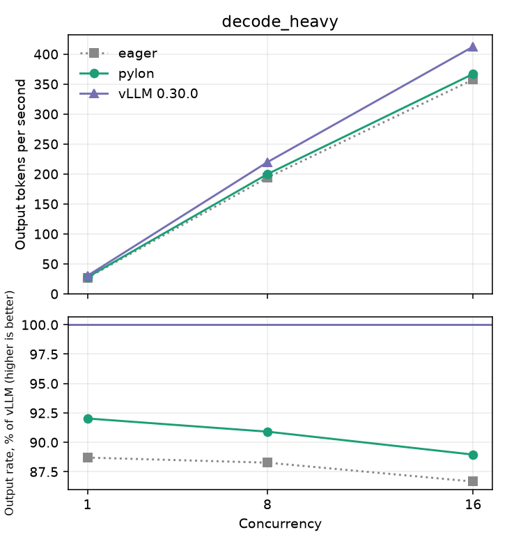
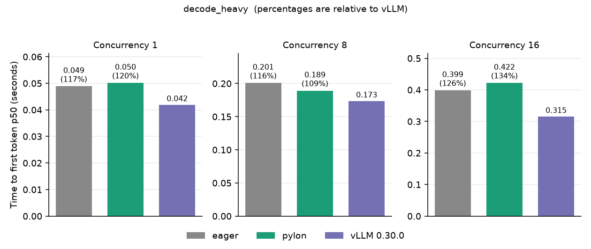

# Pylon

[](LICENSE)
[](#requirements)
[](#requirements)

Pylon is a single-GPU inference server for [Qwen3-4B-Instruct-2507](https://huggingface.co/Qwen/Qwen3-4B-Instruct-2507). The weights stay fixed. It exposes an OpenAI-compatible `POST /v1/chat/completions` endpoint.

The additions on top of a normal serving loop are packed decode and prefill ticks, CUDA-graph decode, a two-hit prefix cache, prompt n-gram verification, and skip-ahead admission.

On one NVIDIA L4, Pylon produces 74% to 92% of the output tokens per second of vLLM 0.30.0 on three workloads, and has a lower median time to first token on long prompts at concurrency 8 and 16. It is slower to first token when most of a prompt is cached, and its inter-token latency is higher while long prompts are being prefilled.

## Contents

- [What it does](#what-it-does)
- [Benchmark](#benchmark)
- [Requirements](#requirements)
- [Run](#run)
- [Unit tests](#unit-tests)
- [Smoke check](#smoke-check)
- [Reproduce](#reproduce)
- [License](#license)

## What it does

- **Packed ticks.** Each step runs one forward: one token for every decoding request, plus up to `PYLON_PREFILL_CHUNK_SIZE` (default 2048) prompt tokens taken from as many waiting prompts as fit. Only rows that sample a token run the vocabulary head. If the batch is full and the oldest prompt has waited under 100 ms, the step decodes only. A long prompt in a step makes that step's inter-token gap longer.
- **CUDA-graph decode.** A step with no prompt work replays a captured decode graph, one per batch size up to `PYLON_MAX_BATCH_SIZE` (default 32).
- **Fused projections.** Q, K, and V share one matrix multiply, as do the gate and up projections. Rotary tables are gathered once per forward.
- **Paged KV and a two-hit prefix cache.** KV lives in 256-token pages. A full page of prompt tokens is kept once the same block shows up again. A request admitted before that block was kept still picks it up before its first prompt chunk. `PYLON_PREFIX_CACHE=false` turns that off.
- **Prompt n-gram speculation.** This provides a verify path for speculated tokens. It was off in the benchmark.
- **Skip-ahead admission.** Each request reserves its prompt and its full generation in pages. If the first waiter does not fit, a later one that does can start. `PYLON_ADMIT_SKIP` defaults to 4. A request that has waited 100 ms stays next.

## Benchmark

NVIDIA L4, driver 580.126.20, PyTorch 2.14.1+cu130, CUDA 13.0, Qwen/Qwen3-4B-Instruct-2507 snapshot `cdbee75f17c01a7cc42f958dc650907174af0554`, vLLM 0.30.0. 32 requests per cell, 3 repeats, temperature 0, non-streaming. Pylon runs with batch cap 32 and prefill chunk 2048.

- **decode_heavy:** 128 prompt tokens, 512 new tokens.
- **prefill_heavy:** 2048 prompt tokens, 32 new tokens.
- **shared_prefix:** 640 prompt tokens, the first 512 identical, 64 new tokens.

<p align="center">&nbsp;&nbsp;&nbsp;&nbsp;<br><sub>decode_heavy output tokens per second · decode_heavy time to first token p50</sub></p>

`eager` is this server with CUDA graphs, the prefix cache, speculation, and skip-ahead admission off. `pylon (before)` is the previous version of this server, with batch cap 8 and prefill chunk 256. A dash means that row was not measured.

**Output tokens per second**

| Workload | Concurrency | eager | pylon (before) | pylon | vLLM 0.30.0 |
| --- | ---: | ---: | ---: | ---: | ---: |
| decode_heavy | 1 | 26.7 | – | 27.7 | 30.1 |
| decode_heavy | 8 | 194.0 | 184.0 | 199.8 | 219.8 |
| decode_heavy | 16 | 357.5 | 183.9 | 367.0 | 412.5 |
| prefill_heavy | 1 | 19.9 | 17.4 | 20.2 | 22.9 |
| prefill_heavy | 8 | 54.6 | 35.5 | 53.7 | 64.1 |
| prefill_heavy | 16 | 61.7 | 39.0 | 59.6 | 72.6 |
| shared_prefix | 1 | 25.6 | 25.6 | 27.2 | 29.8 |
| shared_prefix | 8 | 140.5 | 153.2 | 179.2 | 219.1 |
| shared_prefix | 16 | 208.5 | 154.4 | 303.0 | 410.0 |

**Time to first token p50 (ms)**

| Workload | Concurrency | eager | pylon (before) | pylon | vLLM 0.30.0 |
| --- | ---: | ---: | ---: | ---: | ---: |
| decode_heavy | 1 | 49 | – | 50 | 42 |
| decode_heavy | 8 | 201 | 235 | 189 | 173 |
| decode_heavy | 16 | 399 | 21,883 | 422 | 315 |
| prefill_heavy | 1 | 378 | 574 | 386 | 326 |
| prefill_heavy | 8 | 820 | 4,824 | 847 | 1,025 |
| prefill_heavy | 16 | 853 | 11,028 | 893 | 1,080 |
| shared_prefix | 1 | 120 | 53 | 51 | 37 |
| shared_prefix | 8 | 600 | 253 | 245 | 71 |
| shared_prefix | 16 | 742 | 3,363 | 453 | 60 |

**Inter-token p50 (ms)**

| Workload | Concurrency | eager | pylon (before) | pylon | vLLM 0.30.0 |
| --- | ---: | ---: | ---: | ---: | ---: |
| decode_heavy | 1 | 37 | – | 36 | 33 |
| decode_heavy | 8 | 40 | 42 | 39 | 36 |
| decode_heavy | 16 | 43 | 42 | 42 | 38 |
| prefill_heavy | 1 | 39 | 40 | 38 | 34 |
| prefill_heavy | 8 | 122 | 72 | 124 | 83 |
| prefill_heavy | 16 | 224 | 64 | 234 | 173 |
| shared_prefix | 1 | 38 | 39 | 36 | 33 |
| shared_prefix | 8 | 48 | 48 | 41 | 35 |
| shared_prefix | 16 | 63 | 49 | 45 | 37 |

Time to first token is server time from the request joining the queue to the first token. The full tables, with p99 and the prefill tokens each run computed, are in [`benchmarks/tables/summary.md`](benchmarks/tables/summary.md), which names the result file behind every row.

- **Against the previous version:** output tokens per second at concurrency 16 doubled on `decode_heavy` (183.9 to 367.0) and on `shared_prefix` (154.4 to 303.0). On `prefill_heavy` at concurrency 8 and 16, median time to first token fell from 4.8 s and 11.0 s to 0.85 s and 0.89 s, and output rate rose 1.5x. The previous version also had a startup bug that left most of the free GPU memory unused by the KV pool, so long prompts queued behind a handful of requests. With the fix the pool is 11.1 GiB (`kv_budget_bytes` in the result files). The `pylon` rows for `prefill_heavy` were measured after that fix. The other `pylon` rows were measured before it, and no request in them waited more than 140 ms for KV pages.
- **Against vLLM:** `decode_heavy` output rate is 92%, 91%, and 89% of vLLM's at concurrency 1, 8, and 16, with inter-token p50 about 10% higher. `prefill_heavy` median time to first token is lower at concurrency 8 and 16 and higher at concurrency 1, and its inter-token p50 is 1.35x to 1.5x higher at concurrency 8 and 16, because every step carries a 2048-token prefill chunk.
- **Prefix cache:** Pylon reuses whole 256-token pages, so it reuses 512 of the 640 prompt tokens on `shared_prefix` and computes 128 per request. vLLM reuses 16-token blocks and, because every repeat replays the same prompts, computes 16 per request. That is most of the gap in time to first token on that workload.
- **CUDA graphs:** with everything else equal, graphs raise `decode_heavy` output rate by 3.7%, 3.0%, and 2.6% at concurrency 1, 8, and 16.
- **vLLM prefix caching:** vLLM runs with it off on `decode_heavy` and `prefill_heavy`, because every repeat replays the same 32 prompts and a cache would measure hits instead of prefill. It runs with it on for `shared_prefix`, as Pylon does. Eager never uses it.

## Requirements

- An NVIDIA GPU with CUDA. The server exits if CUDA is missing. An L4 (24 GB) is the reference card.
- Python 3.11 or newer, with PyTorch 2.13 or newer.
- For the vLLM column only: `vllm==0.30.0` on `PATH`, in its own environment.

## Run

```bash
uv run pylon
```

The server listens on `127.0.0.1:8000`. `GET /health` is ready after the weights load and warmup finishes.

## Unit tests

To run the unit tests, including those that run without a GPU:

```bash
uv run python -m unittest discover -s tests
```

## Smoke check

<details>
<summary>This runs against a server that is already up. It is not the published result.</summary>

```bash
uv run python benchmarks/run.py \
  --systems eager \
  --workload decode_heavy \
  --concurrency 1 \
  --limit 8 \
  --repeats 1 \
  --label eager-decode-heavy-c1
```

</details>

## Reproduce

Reproduction requires an NVIDIA GPU with CUDA, Python 3.11+, and PyTorch 2.13+. The table above came from one command per system, each writing its own file to `benchmarks/results/`:

```bash
for system in eager pylon vllm; do
  uv run python benchmarks/run.py \
    --systems $system \
    --workload decode_heavy,prefill_heavy,shared_prefix \
    --concurrency 1,8,16 \
    --repeats 3 \
    --label full-$system
done
uv run python benchmarks/summarize.py eager=<file> pylon=<file> vllm=<file>
```

`eager` turns off graphs, the prefix cache, speculation, and skip-ahead admission. `pylon` turns on graphs and skip-ahead admission and leaves speculation off. The prefix cache follows the workload for `pylon` and `vllm`: off for `decode_heavy` and `prefill_heavy`, on for `shared_prefix`. The harness starts one server at a time and stops it before the next. `summarize.py` writes the tables and the two plots.

## License

Apache-2.0. See `LICENSE`.
